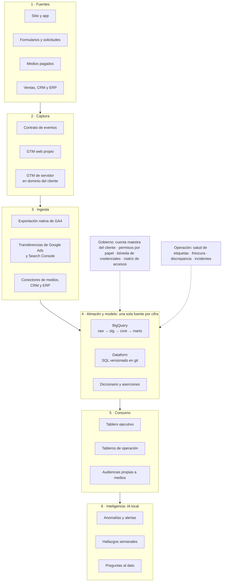
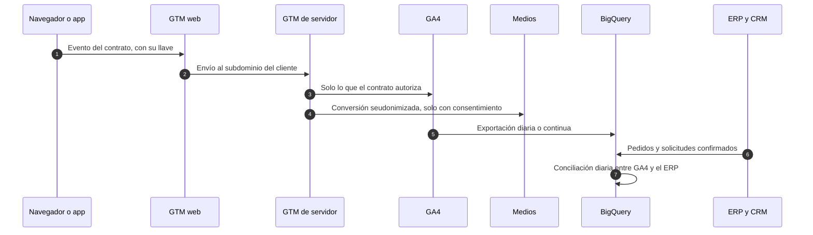
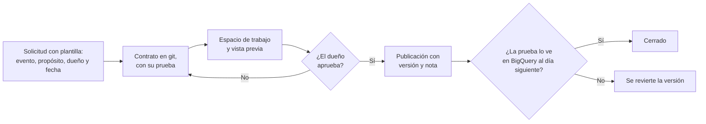
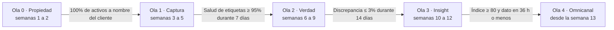

# EDI · Ecosistema Digital Independiente

**Arquitectura de referencia de ArquiTech para que una empresa sea dueña de sus datos digitales: una sola cifra verificable por métrica, en cuentas propias, con un índice que mide cuánto depende todavía de agencias y proveedores.**

El EDI se implementa en cuatro olas en 12 semanas sobre servicios de Google contratados a nombre del cliente, más una capa de IA local que analiza sin enviar datos de terceros a servicios externos. Este repositorio documenta el método: flujo operativo, herramientas, procesos, tratamiento de los datos y cómo se demuestran los resultados. No contiene código, datos ni configuraciones de ningún cliente.

## Contenido

1. [El problema que resuelve](#1-el-problema-que-resuelve)
2. [Principios](#2-principios)
3. [Arquitectura](#3-arquitectura)
4. [Flujo operativo: cómo recaba la información](#4-flujo-operativo-cómo-recaba-la-información)
5. [Cómo analiza la información](#5-cómo-analiza-la-información)
6. [Herramientas y costo de operación](#6-herramientas-y-costo-de-operación)
7. [Procesos operativos](#7-procesos-operativos)
8. [Tratamiento de los datos](#8-tratamiento-de-los-datos)
9. [Resultados: qué se mide y cómo se demuestra](#9-resultados-qué-se-mide-y-cómo-se-demuestra)
10. [Implementación por olas](#10-implementación-por-olas)
11. [Alcance de este repositorio](#11-alcance-de-este-repositorio)

## 1. El problema que resuelve

**Cuando nadie del negocio es dueño de las cuentas, del contrato de eventos ni de la lógica que convierte el dato en cifra, cada área reporta un número distinto y la inversión en medios se decide a ciegas.** Los síntomas más frecuentes:

- Tableros que no coinciden con lo que reportan las plataformas de medios, porque la lógica de negocio vive en fórmulas del tablero y en hojas de cálculo.
- Propiedades de analítica, contenedores de etiquetas y cuentas publicitarias a nombre de agencias, proveedores o personas.
- Embudos de solicitud que cuentan pasos intermedios como conversiones.
- Cambios de etiquetas que esperan semanas a TI o a un tercero.
- Ventas en tienda o con pago diferido que lo digital no ve.
- Histórico que se pierde al cambiar de plataforma o al vencer la retención de la analítica.

El EDI no corrige un tablero: corrige el sistema que lo alimenta.

## 2. Principios

Siete principios deciden cada pieza; una propuesta que viola uno no entra.

1. **El cliente es dueño de todo:** cuentas, contenedores, proyecto de nube, código, tableros y datos. ArquiTech opera como editor y nunca como propietario.
2. **Una cifra, un lugar:** cada métrica se calcula una vez, en SQL versionado dentro del almacén del cliente. El tablero solo la muestra.
3. **Primero el sistema, después el negocio:** no se proyectan ventas mientras la discrepancia supere 3%.
4. **Contrato antes que etiqueta:** un evento existe primero en el contrato (nombre, parámetros, llave, dueño y prueba) y después en el gestor de etiquetas.
5. **Independencia medible:** un índice con fórmula y evidencia, auditado cada trimestre.
6. **El dato de terceros no sale:** la IA analiza tablas sin datos personales; lo identificable se queda en un espacio restringido del cliente.
7. **Sin costo primero, pago con caso de negocio:** cada licencia entra con su métrica, su umbral y su fecha de corte.

## 3. Arquitectura

**Seis capas, de la fuente a la inteligencia, viven en cuentas del cliente; el gobierno las cruza todas y la operación las vigila. La capa 4 es el centro: ahí, y solo ahí, se calcula cada cifra.**



- **Build-time, en el repositorio git del cliente:** contrato de eventos, configuración exportada de los contenedores, modelos y pruebas de Dataform, diccionario de datos e infraestructura como código.
- **Runtime, en servicios:** contenedores de etiquetas, servidor de etiquetado en Cloud Run, GA4, exportaciones y transferencias, BigQuery, Data Studio y el nodo de IA local.
- Todo cambio entra por el repositorio y se publica con versión; nadie edita un servicio en producción a mano.

## 4. Flujo operativo: cómo recaba la información

**El EDI recaba por cuatro vías y une todo con tres llaves: el navegador emite eventos según un contrato, el servidor de etiquetado los reparte, las exportaciones nativas los guardan crudos y el ERP confirma cada venta y cada solicitud.**



| Vía | Qué trae | Cómo llega a BigQuery | Frecuencia |
| --- | --- | --- | --- |
| Sitio, app y embudos | Eventos del contrato | GA4 y su exportación nativa | Diaria; continua opcional |
| Medios pagados | Costo, clics y conversiones | Transferencia de Google Ads; conector de otros medios | Diaria |
| Búsqueda orgánica | Consultas, páginas y clics | Exportación masiva de Search Console | Diaria |
| Sistemas del negocio | Pedidos, solicitudes, ventas en tienda y CRM | Conector administrado o función propia | Diaria |

GA4 estándar exporta hasta 1 millón de eventos diarios a BigQuery; si una propiedad lo rebasa de forma persistente, la exportación diaria se pausa. El contrato excluye los eventos sin uso para quedar debajo del tope.

**Contrato de eventos.** Vive en git y el gestor de etiquetas se configura desde él.

| Familia | Eventos | Llave | Prueba automática |
| --- | --- | --- | --- |
| Navegación y catálogo | page_view, view_item_list, view_item | — | Parámetros obligatorios en 100% de los eventos |
| Comercio | add_to_cart, begin_checkout, add_shipping_info, add_payment_info, purchase | transaction_id | purchase contra pedidos del ERP: diferencia de 3% o menos |
| Solicitud (crédito, cotización o cita) | lead_step con step_number y step_name; lead_submit | application_id | Un evento por paso y solicitud; el final, solo con confirmación del servidor |
| Resultado de negocio | application_approved, offline_purchase | application_id, transaction_id | Llega del ERP por el Protocolo de Medición o por la conciliación |
| Identidad | user_id tras el inicio de sesión | customer_key | Nunca un correo ni un teléfono en claro |

**Tres llaves** unen lo digital con el negocio: `transaction_id` (pedido), `application_id` (solicitud) y `customer_key` (identificador del cliente con hash SHA-256 y sal, calculado en el servidor). Las tablas de análisis solo ven llaves.

**Conciliación diaria.** Un modelo compara lo que reporta GA4 con lo que registra el ERP, por día, marca y canal. Si la diferencia pasa de 3%, se abre un incidente.

## 5. Cómo analiza la información

**La cifra se calcula una vez, en cuatro capas de BigQuery versionadas en Dataform. El tablero la muestra y la IA la vigila, pero ninguno de los dos la recalcula.**

| Capa | Qué guarda | Quién escribe | Quién lee |
| --- | --- | --- | --- |
| raw | Exportaciones tal como llegan | GA4, transferencias y conectores | Solo Dataform |
| stg | Datos limpios, tipados y sin duplicados | Dataform | Dataform |
| core | Entidades: sesión, cliente, pedido, solicitud, campaña y costo | Dataform | Analistas |
| marts | Métricas de decisión: embudo, venta por forma de pago, costo por venta confirmada y conciliación | Dataform | Tableros e IA local |

Cada modelo lleva su descripción en el diccionario y sus aserciones; un modelo que falla una aserción no publica.

**Atribución.** El tablero ejecutivo usa la venta confirmada por el ERP, no la conversión que reporta cada plataforma. Las dos se muestran lado a lado para medir la diferencia.

**Ciclo semanal de análisis:**

1. **Detectar:** la IA compara cada métrica de los marts contra su línea base y marca las desviaciones.
2. **Explicar:** descompone cada desviación por canal, marca, dispositivo y paso del embudo.
3. **Proponer:** redacta una hipótesis y una acción, con la consulta SQL que la sostiene.
4. **Decidir:** una persona del cliente aprueba o descarta. La IA no mueve presupuesto.
5. **Medir:** la acción aprobada entra como experimento con métrica, umbral y fecha de corte.

**IA local.** Un modelo de pesos abiertos corre en un equipo del cliente o en un nodo soberano como [Soberano](https://github.com/ArquiTechB2B/soberano), y lee solo los marts con una cuenta de servicio de solo lectura. Ningún dato va a una API de IA externa sin aprobación escrita del cliente.

**Cadencias.** Diaria: frescura y conciliación del día anterior. Semanal: hallazgos de la IA y una revisión de 30 minutos. Mensual: tablero ejecutivo con la dirección. Trimestral: auditoría del índice de independencia.

## 6. Herramientas y costo de operación

**Para un cliente de referencia, operar el stack base cuesta entre USD 100 y 219 al mes, sin conectores de terceros ni IA local; casi todo el costo fijo es el servidor de etiquetado.** Precios de lista al 19 de noviembre de 2026; cambian sin aviso.

| Capa | Herramienta | Función | Costo de lista | Alternativa |
| --- | --- | --- | --- | --- |
| Gobierno | Organización de Google Cloud del cliente, permisos y bóveda | Propiedad y accesos | Sin licencia nueva si la bóveda ya existe | — |
| Captura | GTM web | Etiquetas del navegador | Sin costo | El gestor que el cliente ya use |
| Captura | GTM de servidor en Cloud Run | Reparte eventos a GA4 y a medios | USD 50 por instancia al mes ([Google](https://developers.google.com/tag-platform/learn/sst-fundamentals/7-planning-infrastructure)) | Hospedaje administrado de terceros |
| Medición | GA4 estándar | Eventos y exportación cruda | Sin costo; tope de 1 millón de eventos diarios en la exportación diaria ([Google](https://support.google.com/analytics/answer/9823238)) | GA4 360, por cotización |
| Ingesta | Transferencia de Google Ads; exportación de Search Console | Medios de Google y búsqueda orgánica | Sin costo de transferencia ([Google Cloud](https://cloud.google.com/blog/products/data-analytics/new-bigquery-data-transfer-service-capabilities)) | — |
| Ingesta | Conectores de otros medios, CRM y ERP | Medios de terceros y sistemas del negocio | Por consumo | Función propia en Cloud Run |
| Almacén | BigQuery | Datos crudos y modelos | Consultas: USD 6.25 por TiB, el primer TiB del mes sin costo. Almacenamiento: alrededor de USD 0.023 por GiB al mes activo y 0.016 a largo plazo; 10 GiB sin costo ([Google Cloud](https://cloud.google.com/bigquery/pricing)) | — |
| Transformación | Dataform | SQL versionado, pruebas y diccionario | Sin costo propio; se pagan las consultas ([Google Cloud](https://cloud.google.com/dataform/pricing)) | dbt |
| Consumo | Data Studio (antes Looker Studio) | Tableros | Sin costo; la versión Pro se cobra por usuario | El tablero que el cliente ya use |
| Inteligencia | Modelo de pesos abiertos en GPU local | Anomalías, hallazgos y preguntas al dato | Equipo del cliente o nodo soberano | — |

**Costo mensual de referencia.** Supuestos: 500,000 eventos al día; unos 600,000 eventos por GiB; dos instancias del servidor de etiquetado; de 1 a 4 TiB de consultas al mes; Data Studio Pro opcional para 10 usuarios a USD 9 cada uno.

| Concepto | Mínimo (USD/mes) | Máximo (USD/mes) |
| --- | --- | --- |
| Servidor de etiquetado, 2 instancias | 100.00 | 100.00 |
| Almacenamiento en BigQuery, del mes 1 al mes 24 | 0.35 | 9.90 |
| Consultas en BigQuery, de 1 a 4 TiB | 0.00 | 18.75 |
| Data Studio Pro, 10 usuarios (opcional) | 0.00 | 90.00 |
| **Total** | **≈ 100** | **≈ 219** |

**Punto de equilibrio.** Se mide contra el costo de la dependencia actual: licencias de pago que el EDI posterga, horas de terceros por cada cambio e inversión de medios mal asignada por la discrepancia.

```math
\text{Meses de equilibrio} = \frac{I}{C_{\text{dependencia}} - C_{\text{EDI}}}
```

`I` es la inversión de implementación y `C` el costo mensual de cada modelo, antes de impuestos.

## 7. Procesos operativos

**Después de la implementación, cuatro procesos sostienen el EDI: el cambio de etiqueta en menos de un día hábil, el incidente de datos, los rituales y la auditoría trimestral. Cada uno tiene un dueño del lado del cliente.**

R = responsable, A = aprueba, C = consultado, I = informado.

| Actividad | Cliente | ArquiTech | TI del cliente | Medios o agencia |
| --- | --- | --- | --- | --- |
| Cuentas, propiedad y accesos | A, R | C | C | I |
| Contrato de eventos | A | R | C | C |
| Contenedores web y de servidor | A | R | C (una sola inserción) | I |
| Capa de datos en el código del sitio | A | C | R | I |
| Modelos de Dataform y pruebas | A | R | I | I |
| Tableros | A | R | I | C |
| Campañas y nomenclatura UTM | A | C (taxonomía) | I | R |
| Incidente de datos | A | R | C | I |
| Auditoría del índice | A | R | I | I |

**Cambio de etiqueta, en menos de un día hábil:**



**Incidente de datos.** Se abre solo cuando una alerta cruza su umbral: frescura mayor a 36 horas, discrepancia mayor a 3% o salud del etiquetado menor a 95%. La primera respuesta llega en 4 horas hábiles, la causa raíz queda registrada y el análisis posterior se entrega en 5 días hábiles. Mientras dure, el tablero ejecutivo marca la cifra afectada.

**Rituales.** Diario y asíncrono: alertas. Semanal, 30 minutos: hallazgos y decisiones. Mensual: tablero ejecutivo con la dirección. Trimestral: auditoría del índice con su evidencia.

## 8. Tratamiento de los datos

**Los datos personales nunca llegan a la analítica ni a la IA: se quedan en un espacio restringido del cliente, y todo lo demás trabaja con llaves seudonimizadas o con cifras agregadas.**

| Clase de dato | Dónde vive | Quién lo ve | Regla |
| --- | --- | --- | --- |
| Personal (nombre, correo, teléfono) | Conjunto restringido del cliente en BigQuery | Solo cuentas autorizadas del cliente | Nunca en GA4, en tableros ni en la IA |
| Seudonimizado (`customer_key`) | Capas stg y core | Dataform y analistas | Hash SHA-256 con sal, calculado en el servidor |
| Agregado (marts) | Capa marts | Tableros e IA local | Sin datos personales; base de toda decisión |
| Envío a medios | APIs de conversiones de cada plataforma | La plataforma | Seudonimizado y solo con consentimiento |

- **Consentimiento y aviso.** La [Ley Federal de Protección de Datos Personales en Posesión de los Particulares](https://www.diputados.gob.mx/LeyesBiblio/pdf/LFPDPPP.pdf), vigente desde marzo de 2025, exige aviso de privacidad y consentimiento y reconoce los derechos de acceso, rectificación, cancelación y oposición. El contrato de eventos respeta el aviso de cada cliente, que revisa su abogado.
- **Retención.** Cada tabla particionada lleva su caducidad; el histórico agregado se conserva y el detalle personal expira según el aviso.
- **Accesos.** Permisos por papel, sin credenciales compartidas; ArquiTech opera con permisos de editor que el cliente revoca al terminar.
- **IA.** El modelo corre en infraestructura del cliente o en un nodo soberano bajo contrato de encargado, y solo lee los marts.

## 9. Resultados: qué se mide y cómo se demuestra

**Cada implementación levanta una línea base en la Ola 0 y cierra la Ola 3 con una auditoría con evidencia. Los resultados de clientes se comparten en privado y con su autorización.**

El Índice de Independencia del EDI (IIE) va de 0 a 100, se audita cada trimestre y está en verde con 80 o más.

```math
\mathrm{IIE} = 0.25\,P + 0.20\,C + 0.20\,V + 0.20\,A + 0.15\,M
```

| Componente | Peso | Cómo se mide (0 a 100) | Evidencia |
| --- | --- | --- | --- |
| P · Propiedad | 25% | Activos críticos con propietario del cliente ÷ activos críticos | Exportación de permisos de cada herramienta |
| C · Captura | 20% | Salud del etiquetado de los últimos 7 días | Resultados de las pruebas del contrato |
| V · Veracidad | 20% | 100 × (1 − discrepancia ÷ 10%), con piso en 0 | Modelo de conciliación |
| A · Autonomía | 20% | Cambios del trimestre hechos dentro del plazo sin esperar a un tercero ÷ cambios | Historial de versiones |
| M · Memoria | 15% | Meses de histórico en el almacén del cliente ÷ 24, con tope en 100 | Particiones de BigQuery |

Semáforo: verde, 80 o más; ámbar, de 60 a 79; rojo, menos de 60.

| Indicador | Fórmula | Verde | Frecuencia |
| --- | --- | --- | --- |
| Discrepancia GA4-ERP | \|GA4 − ERP\| ÷ ERP, en pedidos y solicitudes | 3% o menos | Diaria |
| Salud del etiquetado | Eventos críticos que pasan su prueba ÷ eventos críticos | 95% o más | Diaria |
| Frescura | Horas desde el último dato cargado | 36 h o menos | Diaria |
| Tiempo de cambio | Horas hábiles de la solicitud a la etiqueta publicada | 8 h o menos | Por cambio |
| Resolución de identidad | Sesiones con `customer_key` ÷ sesiones | 30% o más, en sitios con inicio de sesión | Mensual |
| Influencia digital en tienda | Ventas en tienda con `customer_key` visto en la web en los 30 días previos ÷ ventas en tienda con `customer_key` | Línea base en la Ola 4 | Mensual |
| Índice de Independencia | La fórmula de arriba | 80 o más | Trimestral |

Los pesos y los umbrales se calibran con cada cliente durante la Ola 0.

## 10. Implementación por olas

**Cuatro olas en 12 semanas, más una continua. Cada ola abre solo cuando la anterior pasa su puerta, y las semanas corren desde el día en que llegan los accesos.**



| Ola | Qué se construye |
| --- | --- |
| 0 · Propiedad | Inventario de activos y dueños; cuenta maestra; proyecto de nube del cliente; matriz de accesos y bóveda |
| 1 · Captura | Contrato de eventos; contenedor propio en paralelo, primero en las propiedades que el cliente controla; servidor de etiquetado en su dominio |
| 2 · Verdad | Exportaciones a BigQuery; modelos en Dataform; conciliación diaria contra el ERP; diccionario de datos |
| 3 · Insight | Tablero ejecutivo; IA local; rituales; primera auditoría del índice |
| 4 · Omnicanal | Identidad entre canales; ventas en tienda; audiencias propias hacia los medios |

La puerta que manda es la de la Ola 2: mientras la discrepancia no baje de 3% durante 14 días, no se proyectan ventas ni se cobra por resultado.

## 11. Alcance de este repositorio

- Documenta el método y la arquitectura de referencia del EDI.
- No contiene código, datos, credenciales ni configuraciones de clientes.
- No nombra clientes ni publica sus resultados.
- Los precios citados son de lista al 19 de noviembre de 2026 y pueden cambiar.

**Fuentes:** [Precios de BigQuery](https://cloud.google.com/bigquery/pricing) · [Infraestructura del etiquetado de servidor](https://developers.google.com/tag-platform/learn/sst-fundamentals/7-planning-infrastructure) · [Exportación de GA4 a BigQuery](https://support.google.com/analytics/answer/9823238) · [Precios de Dataform](https://cloud.google.com/dataform/pricing) · [BigQuery Data Transfer Service](https://cloud.google.com/blog/products/data-analytics/new-bigquery-data-transfer-service-capabilities) · [LFPDPPP, texto vigente](https://www.diputados.gob.mx/LeyesBiblio/pdf/LFPDPPP.pdf)

© 2026 ArquiTech. Documentación pública del método; todos los derechos reservados.
